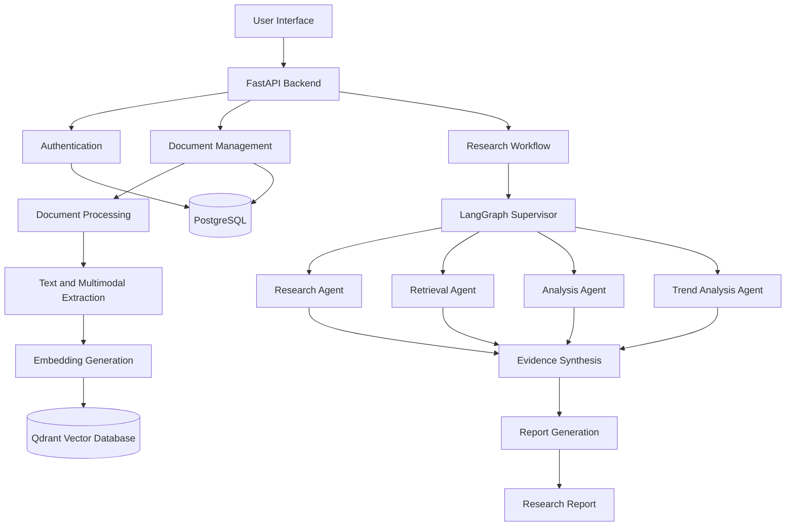

#                                  OrchestrAI
### Agentic AI-Powered Technology Intelligence & Research Automation Platform

<p align="center">
  <strong>Transforming Technology Research into Structured, Evidence-Based Intelligence.</strong>
</p>

<p align="center">
  An AI-powered research platform designed to automate technology discovery, academic document understanding, evidence retrieval, analytical synthesis, and structured research report generation.
</p>

---

## Overview

**OrchestrAI** is an Agentic AI-powered technology intelligence platform designed to streamline the research and analysis process.

The platform aims to combine document intelligence, Retrieval-Augmented Generation (RAG), vector search, and multi-agent orchestration to help users explore emerging technologies, understand research publications, identify technology trends, and generate evidence-based reports.

Instead of manually searching through numerous research papers and technical documents, OrchestrAI aims to coordinate specialized AI agents to retrieve relevant information, analyze findings, synthesize evidence, and produce structured research outputs.

The project is being developed as a modular platform, with an incremental implementation approach that prioritizes reliable document processing, traceable evidence, and scalable agent orchestration.

## Key Objectives

- Automate technology research and information discovery.
- Enable intelligent ingestion and processing of academic research papers.
- Implement semantic search using vector embeddings.
- Develop Retrieval-Augmented Generation (RAG) for evidence-grounded responses.
- Introduce collaborative multi-agent workflows using LangGraph.
- Support structured understanding of equations, tables, figures, charts, and technical diagrams.
- Analyze technology trends and synthesize research findings.
- Generate structured research reports with source references and citations.

## Core Features

### 1. Intelligent Document Processing
Designed to process academic research papers and technical documents.

Planned capabilities include:
- PDF ingestion and validation.
- Text extraction and preprocessing.
- Document chunking and metadata management.
- Structured extraction of tables and equations.
- Figure, chart, and diagram extraction.
- OCR support for scanned documents.
- Source-page and region tracking.

### 2. Semantic Search and Knowledge Retrieval

Uses vector embeddings and Qdrant to enable semantic retrieval across indexed document content.

Current capabilities:
- Text embedding generation.
- Vector indexing.
- Semantic similarity search.
- Document and page metadata.
- User-scoped retrieval through ownership filters.

### 3. Retrieval-Augmented Generation (Planned)

The RAG layer will connect retrieved research evidence with an LLM to generate context-aware responses.

Planned capabilities:
- Context-aware retrieval.
- Evidence-grounded answer generation.
- Source attribution.
- Citation and reference tracking.
- Retrieval relevance evaluation.

### 4. Multi-Agent Research Architecture (Planned)

OrchestrAI is designed around specialized agents coordinated through LangGraph.

| Agent | Responsibility |
|---|---|
| Supervisor Agent | Coordinates research tasks and agent execution |
| Research Agent | Discovers relevant research information |
| Retrieval Agent | Retrieves relevant evidence from the knowledge base |
| Analysis Agent | Examines technical concepts and research findings |
| Trend Analysis Agent | Identifies technology trends and relationships |
| Report Generation Agent | Produces structured research reports |

These are planned application components; the current backend is an early document-indexing and retrieval implementation.

### 5. Research Report Generation (Planned)

The reporting layer aims to transform retrieved evidence and analytical results into structured research documents.

Expected output components:
- Executive summary.
- Research objectives and methodology.
- Technology overview.
- Literature and evidence analysis.
- Comparative tables.
- Equations and mathematical representations.
- Figures, charts, and architecture diagrams.
- Findings and conclusions.
- References and citations.

---

## System Architecture

The intended high-level architecture separates document processing, knowledge retrieval, multi-agent orchestration, and report generation.



*Note: This illustrates the target architecture. Several components, particularly LangGraph orchestration, multimodal extraction, and report generation, are planned rather than implemented.*

## Technology Stack

| Layer | Technology | Purpose |
|---|---|---|
| Backend | Python | Core application logic |
| API Framework | FastAPI | REST API development |
| Database | PostgreSQL | Structured application data |
| ORM | SQLAlchemy | Database interaction |
| Migrations | Alembic | Database schema management |
| Vector Database | Qdrant | Semantic vector storage and retrieval |
| Embeddings | Sentence Transformers | Text embedding generation |
| Embedding Model | all-MiniLM-L6-v2 | 384-dimensional embeddings |
| Agent Framework | LangGraph (planned) | Multi-agent orchestration |
| Frontend | React + TypeScript (planned) | User interface |
| LLM Provider | To be evaluated | Research synthesis and reasoning |

## Current Implementation Status

OrchestrAI is under active development.

| Component | Status |
|---|---|
| Project architecture and specification | Completed |
| Python backend foundation | Implemented |
| FastAPI REST API | Implemented |
| User registration and authentication | Implemented; live PostgreSQL verification pending |
| PDF text extraction | Implemented |
| Text preprocessing and chunking | Implemented |
| Sentence Transformer embeddings | Implemented |
| Qdrant vector indexing | Implemented |
| Semantic search API | Implemented |
| User-scoped retrieval | Implemented |
| PostgreSQL production configuration | Pending |
| Structured layout extraction | Under evaluation |
| Table extraction | Under evaluation |
| Equation and formula extraction | Planned |
| Figure and diagram extraction | Planned |
| Scanned PDF OCR | Planned |
| RAG generation | Planned |
| LangGraph multi-agent orchestration | Planned |
| Technology trend analysis | Planned |
| Research report generation | Planned |
| React frontend | Planned |
| Deployment | Planned |

## Project Structure

```text
Orchestr-AI/
│
├── .agents/
│   └── skills/
│       └── diagram-design/
│
├── backend/
│   ├── data/
│   │   └── papers/
│   │       └── sample_paper.pdf
│   │
│   ├── migrations/
│   │   └── versions/
│   │
│   ├── orchestrai_review2/
│   │   ├── api/
│   │   │   └── v1/
│   │   │       ├── auth_routes.py
│   │   │       └── routes.py
│   │   │
│   │   ├── auth_service.py
│   │   ├── config.py
│   │   ├── database.py
│   │   ├── embeddings.py
│   │   ├── models.py
│   │   ├── pdf.py
│   │   ├── pipeline.py
│   │   ├── service.py
│   │   ├── text.py
│   │   └── vector_store.py
│   │
│   ├── tests/
│   ├── .env.example
│   ├── alembic.ini
│   ├── requirements.txt
│   └── README.md
│
├── docs/
│   ├── diagrams/
│   └── spec/
│       ├── agent-graph.mmd
│       ├── erd.dbml
│       └── orchestrai-spec.md
│
├── skills-lock.json
├── .gitignore
└── README.md
```

`.agents/` contains development tooling and diagram-design instructions. It is not part of the application's runtime.

## Getting Started

### Prerequisites

Install the following:

- Python 3.11+ (the current development environment uses Python 3.13).
- Git.
- Docker Desktop.
- A running Qdrant instance.
- PostgreSQL database for authenticated application workflows.

### 1. Clone the Repository

```bash
git clone https://github.com/shoebtech98/Orchestr-AI.git
cd Orchestr-AI
```

### 2. Set Up the Backend

```bash
cd backend

python -m venv .venv
```

Activate the environment.

**Windows PowerShell:**

```powershell
.venv\Scripts\Activate.ps1
```

**Linux/macOS:**

```bash
source .venv/bin/activate
```

### 3. Install Dependencies

```bash
python -m pip install -r requirements.txt
```

### 4. Configure Environment Variables

Create your local environment file:

```powershell
Copy-Item .env.example .env
```

Configure the required values in `backend/.env`:

```env
DATABASE_URL=your_postgresql_connection_string
JWT_SECRET_KEY=your_new_secure_secret
QDRANT_URL=http://localhost:6333
```

Use actual credentials locally. Never commit `.env` or expose database passwords and JWT secrets.

### 5. Start Qdrant

If using Docker:

```bash
docker run -p 6333:6333 -p 6334:6334 qdrant/qdrant
```

Qdrant dashboard:

```text
http://localhost:6333/dashboard
```

### 6. Run Database Migrations

After configuring a valid PostgreSQL connection:

```bash
python -m alembic upgrade head
```

### 7. Start the FastAPI Server

```bash
python -m uvicorn orchestrai_review2.api:app --reload
```

API documentation:

```text
http://127.0.0.1:8000/docs
```

> Verify the application's configured ASGI entry point and environment settings against the current backend README before running these commands.

## API Endpoints

The current backend exposes the following API operations:

| Method | Endpoint | Purpose | Authentication |
|---|---|---|---|
| GET | `/api/v1/health` | Health check | Not required |
| POST | `/api/v1/auth/register` | Register a user | Not required |
| POST | `/api/v1/auth/login` | Authenticate a user | Not required |
| POST | `/api/v1/documents` | Upload and index a PDF | Bearer token |
| POST | `/api/v1/search` | Semantic document search | Bearer token |

### Example: User Registration

```http
POST /api/v1/auth/register
Content-Type: application/json
```

### Example: User Login

```http
POST /api/v1/auth/login
Content-Type: application/json
```

### Example: Semantic Search

```http
POST /api/v1/search
Authorization: Bearer YOUR_ACCESS_TOKEN
Content-Type: application/json
```

```json
{
  "query": "How do batteries improve solar energy reliability at night?"
}
```

Refer to the interactive Swagger documentation at `/docs` for the exact request and response schemas.

## Testing

Run the backend test suite:

```bash
python -m pytest -v
```

The tests cover the implemented PDF, text-processing, API, authentication, and vector-store functionality.

## Development Roadmap

OrchestrAI is being developed incrementally.

| Phase | Development Focus |
|---|---|
| Phase 1 | Repository and environment setup |
| Phase 2–5 | Database foundation, API, and authentication |
| Phase 6–8 | Document management, extraction, and vector indexing |
| Phase 9 | Retrieval-Augmented Generation |
| Phase 10–14 | Specialized agents and LangGraph orchestration |
| Phase 15–17 | Model routing and complete research workflow |
| Phase 18–20 | Frontend, integration, and testing |
| Phase 21–23 | Security, deployment, and documentation |

The roadmap is subject to implementation and validation milestones.

## Design Principles

OrchestrAI follows these engineering principles:

- **Modularity:** Separate document processing, retrieval, orchestration, and reporting.
- **Evidence Grounding:** Research outputs should be supported by traceable source material.
- **Data Integrity:** Preserve original documents and extraction provenance.
- **Scalability:** Use independently managed application and vector-storage layers.
- **Security:** Enforce authentication and user-level data isolation.
- **Evaluation:** Validate extraction and retrieval quality using representative research documents.
- **Cost Awareness:** Prefer local and open-source processing components where practical.

## Future Scope

Future development aims to introduce:

- Multimodal academic document understanding.
- Mathematical expression recognition and LaTeX extraction.
- Structured table extraction and interpretation.
- Figure, chart, and technical diagram understanding.
- OCR for scanned research publications.
- Multi-agent research automation.
- Technology landscape and trend analysis.
- Citation-aware report generation.
- Exportable research reports.
- Interactive research dashboards.

## Contributing

Contributions, suggestions, and technical discussions are welcome.

For development contributions:

1. Fork the repository.
2. Create a feature branch.
3. Implement changes with appropriate tests.
4. Verify that existing functionality remains intact.
5. Submit a pull request with a clear description.

## License

A repository-level license has not yet been specified. Licensing terms will be added after the project owner selects an appropriate license and verifies third-party component requirements.

## Project Information

**Project:** OrchestrAI  
**Category:** Agentic AI | Technology Intelligence | Research Automation  
**Development:** Academic Final-Year Engineering Project  
**Repository:** [shoebtech98/Orchestr-AI](https://github.com/shoebtech98/Orchestr-AI)

---

<p align="center">
  <strong>OrchestrAI — From Research Discovery to Intelligent Decisions.</strong>
</p>
